# Character Preview：实现、接线与使用

本功能把已有角色界面中的选中角色投影到独立的展示 Actor，通过 SceneCapture2D、运行时 RenderTarget 和 UI 材质显示。实现位于 UE 5.6 的 `HSR` Runtime 模块，没有引入 UnrealEd 或 AdvancedPreviewScene 依赖。

本文说明源码中的实际设计；构建、Automation、PIE、打包、截图与性能的最终结果统一见 [VALIDATION.md](VALIDATION.md)。代码存在、资产保存和编译成功分别是不同证据，不能据此推定完整运行验收通过。

## 1. 定向审计与数据所有权

| 问题 | 当前源码事实与入口 |
|---|---|
| 如何标识角色？ | `UHSRCharacterDefinition::CharacterId` 使用稳定 `FName`；存档/养成通过此 ID 关联，不依赖 Pawn 指针。定义位于 `Source/HSR/Data/Definitions/HSRCharacterDefinition.h`。 |
| 谁维护角色列表和已拥有角色？ | `UHSRCharacterProfileSubsystem` 持有 `Definitions`、`Profiles`；`RegisterLoadedCatalog` / `RegisterDefinitions` 为注册定义建立初始档案。当前项目没有独立的解锁账本，UI 以 `GetAllProfileSnapshots` 返回的档案集合为可选范围；预览请求还会验证 `GetProfileSnapshot` 和 `GetDefinition`。 |
| 如何取队伍及当前操控角色？ | `UHSRPartySubsystem::GetSnapshot` 返回 `Slots`、`ActiveSlot` 和 `Revision`；`AHSRPlayerController::GetPawn` 是世界 Pawn。`UHSRCharacterShellViewModel::SelectInitialCharacter` 优先采用活动槽位。预览不读取或复制 Pawn。 |
| Mesh 与动画配置在哪里？ | 既有定义的 `CharacterMesh`、`AnimationClass` 是软引用。本次增加 `PreviewIdleAnimation`、`PreviewYaw`、`PreviewOffset`、`PreviewScale`，只服务展示。预览不实例化战斗/移动 AnimBP。 |
| 装备是否有外观？ | `UHSREquipmentDefinition` 当前只有 ID、槽位、强化上限及数值 modifiers，没有武器外观 Mesh 字段；本次不实现装备外观联动。 |
| UI 如何取快照和接收变化？ | Profile 快照含 `RuntimeRevision`，通过 `OnProfileChanged(FName,int64)` 通知；CharacterShell ViewModel 读取 Profile/Party，并组合 CharacterDetail 和 EquipmentDetail 快照，向 Widget 广播 `FHSRCharacterShellSnapshot`。预览只消费其中的选中 ID。 |
| 角色面板及打开/关闭由谁控制？ | 已有 `UHSRCharacterShellWidget`，资产为 `/Game/UI/P17/Character/WBP_CharacterShell_P17`。`UHSRUIManagerSubsystem` 管理屏幕、输入、焦点、暂停及返回，HUD 注册 Widget 类。预览不增加导航系统。 |

注册与初始队伍种子来自 `Source/HSR/Framework/HSRGameModeBase.cpp`。角色档案、装备、队伍、GAS、存档继续保持原有权威；预览不调用任何修改这些数据的 API。尤其不能复用 `AHSRCharacterBase::SetProjectedCharacterId`：该函数同时写入 ASC 基础属性并投影装备。

## 2. 真实入口与数据流

```mermaid
flowchart LR
  A[Tab 暂停菜单 → 角色] --> B[UIManager OpenFrontendModule Character]
  B --> C[CharacterShellWidget + 原有 ViewModel]
  C -->|SelectedCharacterId| D[CharacterPreviewWidget]
  D --> E[Widget 拥有的 PreviewSession]
  E -->|只读 Profile / Definition| F[异步加载 Mesh + PreviewIdle]
  F --> G[PreviewStage / SkeletalMesh]
  G --> H[SceneCapture2D]
  H --> I[运行时 BGRA8 RenderTarget]
  I --> J[UI Material → UMG Image]
```



1. `AHSRPlayerController::RequestOpenCharacterDetailScreen` 提交 Character 模块请求。
2. `UHSRUIManagerSubsystem::OpenFrontendModule` / `OpenCharacterDetailInternal` 将原角色 shell 装入共享模块根节点，保持 UIOnly、焦点和暂停策略。
3. `UHSRCharacterShellWidget::NativeConstruct` 在原 WBP 的 `CharacterPreviewHost` 创建 `UHSRCharacterPreviewWidget`，注入 `PreviewMaterial`；继续初始化原有 ViewModel。
4. `HandleShellChanged` 将有效快照的 `SelectedCharacterId` 交给 `SetCharacter`；原有角色列表的点击仍经 ViewModel 校验。
5. `UHSRCharacterPreviewSession::RequestCharacter` 验证档案与定义，异步加载展示资源；`CompleteLoad` 创建 stage、配置资源和相机，先提交首次 Capture 填充复用 RT，再通知 UI Ready，避免短暂暴露上一角色画面。

没有作为数据源的新 Subsystem，没有第二份 roster，也不要求目标角色已在大世界生成。

## 3. 三个核心职责

| 文件 | 关键函数与职责 |
|---|---|
| `Source/HSR/UI/Character/HSRCharacterPreviewWidget.{h,cpp}` | `RebuildWidget` 创建 Image、状态文字和重置按钮；`NativeConstruct/NativeDestruct` 管理 session；鼠标事件提交旋转/缩放意图；`NativeTick` 仅同步布局尺寸。 |
| `Source/HSR/UI/Character/Preview/HSRCharacterPreviewSession.{h,cpp}` | `RequestCharacter/CompleteLoad` 管理资源请求；`EnsureRenderTarget` 分配/调整 RT；`TickPreview` 调度动画与捕获；`Close/OnWorldCleanup` 清理生命周期。 |
| `Source/HSR/UI/Character/Preview/HSRCharacterPreviewStage.{h,cpp}` | `Configure` 设置纯展示 Mesh/动画；`Reframe/UpdateCamera` 自动构图；`Rotate/Zoom/ResetView` 改展示变换；`UpdateAnimation/Capture/Stop` 负责呈现。 |
| `Source/HSR/UI/Character/HSRCharacterShellWidget.{h,cpp}` | 复用现有角色快照、选择和面板销毁，挂接预览子控件。 |
| `Source/HSR/Data/Definitions/HSRCharacterDefinition.h` | 定义展示资源软引用与少量每角色覆盖参数；不改变运行时养成或存档结构。 |

## 4. 同 World stage 的隔离策略

采用当前运行时 UWorld 中的 transient `AHSRCharacterPreviewStage`，而不是编辑器 PreviewScene。这样可使用普通 Runtime Actor/Component、现有资源加载与同一渲染场景，不依赖编辑器模块或另一个 World 的手工初始化和销毁。

隔离不是依赖“放得足够远”：stage 可以生成在原点，Mesh 使用 `SetVisibleInSceneCaptureOnly(true)`，主游戏视图不显示它；Capture 使用 `PRM_UseShowOnlyList` 且只加入自己的 Mesh，不捕获周边角色和场景。stage 禁用复制、碰撞、重叠、物理、导航影响、Gameplay Tick、阴影、布料和 post-process AnimBP；没有 ASC、Controller 或 AI。两盏专用点光源及 Mesh 使用 lighting channel 2。

当前项目需保持 channel 2 为展示用途。该策略仍共享渲染场景：未来若游戏对象也使用 channel 2，或添加其他会捕获 SceneCaptureOnly primitive 的 Capture，应重新审计光照与过滤。它不等同于完全独立的渲染 World。独立 Runtime PreviewScene 能提供更强隔离，但需要额外世界、场景注册、时间推进和资源清理；当前单预览窗口不承担这部分复杂度。

## 5. 自动构图和交互

`Configure` 先在初始姿态更新 Mesh Bounds，将真实 Bounds 中心移到展示 pivot；因此导入 pivot 不在中心时旋转不会绕偏移轨道。`PreviewOffset` 是可选展示偏移，`PreviewScale` 受有限值与范围校验。空/异常半径采用安全回退。

`Reframe` 使用包围球半径 R、35° 水平 FOV 和 RT 宽高比计算垂直半视角，再取较小半视角 θ：`FitDistance = R × 1.12 / sin(θ)`。球体构图对水平旋转保守但稳定；宽高比变化会重新构图。滚轮按乘法改变距离，并限制在 `FitDistance / 1.10` 至 `FitDistance × 1.6`，近端仍保留完整 Bounds 余量。默认视角、角色切换和重置均恢复适配距离及 `PreviewYaw`。

左键拖动使用局部像素位移乘以当前源码系数 `0.4°/pixel`，不乘帧时间；滚轮使用事件增量，不改变世界相机。失去捕获、释放按钮或拖出预览区域结束拖动。输入模式、暂停和 Escape/Back 继续由原 UIManager 处理。

当前 Bounds 基于配置时姿态与资产 Bounds，不逐帧重新计算镜头。后续新增大幅摆动动作时需要扩充动画 Bounds 或提供保守 framing 配置；不能把 idle 验证推广到任意动作。

## 6. RT、颜色和 UI 资产接线

`EnsureRenderTarget` 创建一个由 session 引用的 transient RT，同一打开会话切换角色时复用。按布局宽高比以高度 768 为起点，最长边受 `RenderTargetMaxDimension` 限制（128～1024，默认 1024），最短边至少 32；改变尺寸时调用 `ResizeTarget`，不逐帧新建资源。关闭会话释放引用，下次打开重新分配。

- Capture：`SCS_FinalColorLDR`，关闭每帧自动捕获及移动自动捕获。
- RT：`PF_B8G8R8A8`，`TargetGamma=2.2`，无自动 mip。
- 后处理：手动曝光，关闭 Lumen GI/反射、雾、天空光、Bloom、MotionBlur、SSR、AO、反射环境及 decals。
- UI：`/Game/UI/CharacterPreview/M_CharacterPreview` 使用 UI Domain、Opaque，参数 `PreviewTexture` 的 RGB 连接 Final Color；Widget 创建一次 MID 并更新纹理参数。

这是可靠的不透明深色背景方案，不宣称透明合成。LDR 的 Alpha 不作为角色遮罩使用。色彩、材质明暗、边缘和 UI 拉伸的实测结论见验证记录；Gamma 配置本身不能证明视觉正确。

`Tools/Presentation/author_character_preview.py` 通过现有 Editor bridge 为原 WBP `MainHBox` 添加中间 `CharacterPreviewHost`，保存 UI 材质，并写入四个原 DataAsset 的 idle/yaw 字段。脚本校验 Mesh/idle 的 Skeleton 一致，在 `Saved/CharacterPreview/BeforeAssets` 保留原资产副本/哈希，输出 `Saved/CharacterPreview/asset_wiring.json`。此文件是资源接线证据，不替代重新打开、PIE 或打包验证。

## 7. 异步请求、GC 与关闭

session 状态为 Closed、Loading、Ready、Error。重复选择处于 Loading/Ready 的同一 ID 直接返回。每次取消/替换/关闭都递增 `RequestGeneration` 并取消 `FStreamableHandle`。弱 UObject 加载委托还会检查 captured generation、Loading 状态及 World 有效性；旧 A 请求不会覆盖新 B 请求。Loading 广播后再次检查 generation，覆盖监听者在回调中关闭或重新选择的情况。

Widget 以 `UPROPERTY(Transient) TObjectPtr` 持有 session；session 同样持有 RT、stage、加载期间的定义。World 与 Profiles 是 `TWeakObjectPtr`，不延长业务宿主寿命。完成加载后 Mesh/动画由组件维持 GC 引用，释放 handle 与 PendingDefinition。`TObjectPtr` 是 GC 可追踪 UObject 引用，不是 C++ 独占智能指针；本实现不用 AddToRoot。

`NativeDestruct` 解绑状态委托并 `Close`。`Close` 失效化请求、停 Core ticker、移除 WorldCleanup 委托、Stop/Destroy stage、清 RT；`OnWorldCleanup` 还清宿主弱引用，stage `EndPlay` 再停止组件。`BeginDestroy` 是遗漏显式关闭时的兜底，GC 期间不直接修改 World Actor 列表，而以弱引用排到游戏线程安全销毁。正常路径仍应是 Widget 显式关闭。

## 8. 暂停时间与无业务动画

现有角色页面属于暂停菜单，World 时间停止。因此预览使用 `FTSTicker::GetCoreTicker()` 的实时时间，而不是 World Timer 或解除暂停。动画只用匹配 Skeleton 的 SingleNodeInstance，关闭其自动播放与组件 Tick；每个捕获间隔由 session 推进时间、`SetPosition(time, false)`，再以零 Delta 更新 pose/bones，避免执行 AnimNotify 中的音频、特效或业务回调。没有匹配 idle 时保留静态 Mesh 姿态。

`CaptureFramesPerSecond` 可配置为 1～30（默认 30）；累计时间达到间隔才处理一次，不追补多次 Capture；每次动画推进最多 1 秒，长时间卡顿会丢弃过长的间隔。动画存在时持续采样并捕获；静态模型仅 dirty 时捕获；关闭时无 ticker、无 stage。静态 Ready 会话仍有轻量 ticker 检查，不产生连续额外渲染。`RotationDegreesPerPixel` 配置局部拖动位移对应角度，默认 0.4。

## 9. 资产、Cook 与发行边界

当前四个本地角色的 `Demo.Character.*` ID 为 Huohua、EvernightMoon、Remiel、Verina。mesh 来自既有 `Content/Assets/mmd/Character/{Sparxie,Evernight,Ramiel,Velina}`；idle 来自 `/Game/Presentation/Animation/Locomotion/<Name>/FINAL_<Name>_MM_Idle`。没有下载、复制或改写原 Mesh/动画。

`Config/DefaultGame.ini` 已将 `/Game/Data/VerticalSlice` 与 `/Game/UI` 列入 AlwaysCook；角色 DataAsset 的软引用建立 Mesh/idle 的依赖，WBP 默认属性持有 UI 材质引用。应从正式地图/目录 → DA → soft Mesh/idle 和 WBP → Material 检查 Cook 依赖；不能以 Editor 已驻留资源证明包内存在。以 [VALIDATION.md](VALIDATION.md) 的实际 Cook/非编辑器运行记录为准。

MMD 本地现有资源未形成完整的公开再分发授权证据。此次接线不赋予新的发行权，也不把商业角色称为原创角色。授权风险不能用 Mixamo/Kachujin 的历史 owner acceptance 替代。公开上传或对外分发包前应替换为授权明确的资产或完成对应授权核验。

## 10. 性能、验证及操作

BGRA8 RT 的颜色面基础占用为 `宽 × 高 × 4` 字节，例如 512×768 约 1.5 MiB、1024² 为 4 MiB；这只是格式估算，不包括 Capture 的深度/中间缓冲、渲染器常驻资源及驱动开销，也不是实测显存。Capture 的实际 CPU/Render Thread/GPU 成本必须通过运行测量。

默认上限约 30 captures/s，降低 RT 尺寸、禁用高成本特效、保持一个 Capture、静态按需刷新、关闭彻底停止，是当前实现的成本控制。未来可按设备配置分辨率和频率、复用会话或使用 idle pose 缓存，但当前不声称这些策略已实现。

最短体验路径：打开 `HSR.uproject` → 正式默认地图 `Map_ObservationCar` → Play → Tab → 角色 → 左侧选择角色 → 预览区左拖/滚轮/重置 → Esc 返回或 X 关闭前端。正常输入导航沿用当前游戏配置。

复现命令（先检查本机路径和运行中的 Editor 状态）：

```powershell
& 'E:/programs/Epic Games/UE_5.6/Engine/Build/BatchFiles/Build.bat' HSREditor Win64 Development '-Project=E:/work/unreal_projects/HSR/HSR.uproject' -WaitMutex
python Tools/Presentation/character_preview_bridge.py Tools/Presentation/author_character_preview.py
python Tools/Presentation/character_preview_bridge.py Tools/Presentation/run_character_preview_tests.py
python Tools/Presentation/character_preview_bridge.py Tools/Presentation/verify_character_preview_pie.py
```

上述测试脚本的前置条件和实际执行结果见验证记录。打包复用项目 `Tools/Presentation/package_windows.ps1`；发布授权与编译/打包技术验证分别记录。性能对比应固定分辨率、画质、地图与硬件，记录关闭基线、静态、idle、旋转、连续切换的 Game/Draw/GPU，使用 stat unit/stat gpu 或 Insights，保留预热和采样窗口，不在本文填入推测数字。

## 11. 未来扩展（尚未实现）

换装需从原装备权威读取外观快照，再为 stage 添加只展示的附属组件；不能把装备真源搬进 UI。动作预览可在现有 generation 与无 Notify 采样机制上切换序列，但需补动作 Bounds、循环策略和资源优先级。多角色展示可扩展 stage 的组件集合与联合 Bounds，ShowOnly 清单也需同步；它会提高蒙皮及渲染成本。完全独立的 runtime scene、透明背景、动态画质策略和多窗口会话池均属于后续设计。

本机 Development 包已按用户明确授权完成验证。最终包目录 `Saved/CharacterPreview/Package/Windows`；与旧 `Saved/Presentation/Package` 分开保存。非 Shipping 专项命令 `HSR.CharacterPreviewProbe` 定义于 `Source/HSR/Tests/HSRCharacterPreviewPackagedProbe.cpp`，仅显式启动时测试现有 UI/session，输出报告和真实 RT/UI PNG，不属于正常玩家流程。
