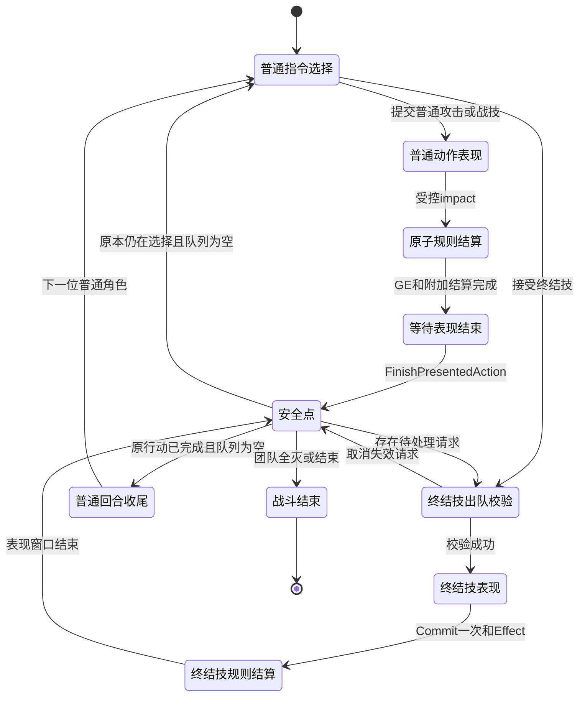

# 终结技仲裁：源码讲解与二面追问

状态：**资料已补充、待个人复习**。本文解释本轮真实源码，不代表开发者已经掌握，也不代表人工验收通过。构建、自动化、图形运行和最终验收结果，以本目录最终测试矩阵及交接报告为准；本文记录的审查推导不冒充运行复现。

## 45 秒回答

我把终结技看作普通回合之间的额外行动。原有 TurnManager 继续维护速度和行动值，BattleCoordinator 在同一 GameThread 接受终结技，并分配单调递增序号。普通攻击执行中，输入可以排队，但伤害、附加效果和表现窗口结束前不会抢占。到安全点，按接受顺序重新检查角色、目标、能量和 Ability，再交给原 ASC 激活。Ability 提交一次 Cost GE，应用伤害或治疗 GE，然后结束；Coordinator 再处理下一个终结技，最后恢复普通行动选择或原回合收尾。终结技不调用普通回合 ResolveAction，所以不会额外重置行动值或减少普通回合 Buff。重复输入由请求身份和角色挂起状态拦截，旧战斗回调由 Generation 隔离。

## 3 分钟架构讲解

第一层是基础行动。`UHSRTurnManager::Initialize` 根据角色 ASC 的速度初始化行动距离；`AdvanceToNextValidTurn` 统一推进到下一位；`ResolveAction` 产生真正的普通回合结束，再补回基础行动距离。这些函数仍是原项目的唯一行动值真源。

第二层是额外行动仲裁，直接扩展原有 `UHSRBattleCoordinator`。UI 经 `SubmitBattleCommand` 提交意图，终结技进入 `RequestUltimate`。请求携带 ActionId、BattleId、角色和目标稳定 ID，协调器附加 BattleGeneration 和 AcceptedSequence。一个角色只能挂起一次请求；重复 ActionId 返回已有结果，不会再次激活 Ability。序号由 GameThread 接受事件分配，因此同帧输入也有确定顺序，不需要用浮点时间戳猜先后。

第三层是安全点。`PumpBattleFlow` 不能在 `PresentedAction`、正式伤害事务或指令派发尚未结束时运行。图形路径由 `QueuePresentedAction` 开始演出，`ApplyPresentedAction` 在受控前摇后执行规则，`FinishPresentedAction` 在表现窗口结束后开放下一个动作。规则执行和表现结束是两个不同条件：动画 Notify 不承担唯一完成信号。当前实现使用有界 Timer，而没有等待可能丢失的 Notify。

第四层是 GAS。`RequestActionCore` 校验目标并交接到原 ASC；伤害走 `PrepareFormalDamage` 接缝。`UHSRUltimateAbility::CanActivateAbility` 同时检查自身资源、状态和 GAS 的基类条件；`ActivateAbility` 内才 `CommitAbility`。`ApplyCost` 通过 `WasSuccessfullyApplied()` 确认 GE 已执行；Instant GE 无需持续存活的 ActiveHandle，因此不能误用 `IsValid()`。Energy 净变化只用于诊断，因为消耗委托可能同时合法恢复能量。Ability 在同步 Cost/Effect 段暂时不可取消，避免属性委托把动作切在扣能量与效果之间。失败补偿仍通过等额 Energy GE，UI 和 Coordinator 都不直接改 Energy。

最后恢复普通流程。`ResolveActionOrWait` 对终结技直接返回，不把它结算成普通回合。普通行动已经打出的情况只保存 `SuspendedNormalFinalization`，等终结技队列排空才调用原 `ResolveAction`；原本仍在选择指令的角色则继续选择。Buff 仍监听原有普通回合事件。速度或行动提前效果仍走 TurnManager 的正规接口，终结技不消耗行动值，并不禁止其效果改变行动值。

这里是本项目源码的实现选择，不是对商业游戏内部源码结构的推断。普通技能、单敌攻击终结技和全队治疗终结技共用原 ASC、AttributeSet 和协调器，没有第二套战斗属性或回合框架。

## 八个追问

### 1. 为什么不能直接插进普通行动值数组？

普通数组承担时间推进和普通回合生命周期。把终结技伪装成一位正常行动者，会让它经过 `ResolveAction`，进而充值 BaseAV、广播 TurnEnded，并可能消耗原角色的行动机会。当前实现让 `PendingUltimates` 与普通行动距离逻辑分离；只有明确的速度变化或 `RequestActionDistanceAdjustment` 等效果能修改 AV。

### 2. 多个终结技近乎同时触发时如何保证顺序？

`RequestUltimate` 在 GameThread 用 `++NextUltimateSequence` 分配 AcceptedSequence；`PendingUltimates` 按实际接受顺序消费。输入来自同一帧不等于没有事件顺序。当前没有真正多线程提交入口；未来如增加网络或工作线程输入，须先汇聚到统一接受点，再明确等价并发的稳定 Slot/ID 规则。不能将本轮串行输入合同描述成已经实现网络同步。

### 3. 为什么不能中途取消正在执行的攻击？

伤害、破韧、状态和死亡处理可能在同一原子事务中，直接停动画不能撤销已结算的 GE，也可能使未到命中点的伤害丢失。`PumpBattleFlow` 等待规则事务和 `PresentedAction` 都结束才开始下一个终结技。`UHSRUltimateAbility` 的 Cost/Instant Effect 段使用 `SetCanBeCanceled(false)`；正常结束前恢复原可取消状态，并仅在仍激活时 EndAbility。系统在提交前可以强制取消，已结算的有效效果不会因战斗结束再被倒算。

### 4. 已排队但能量、角色或目标失效怎么办？

排队只代表接受意图，没有提前扣能量。`ValidateUltimate` 在接受、出队以及图形 impact 前重新检查；Generation、存活、能力、目标和能量任一失败，记录取消结果并继续队列。单体目标不会被偷偷替换。团队目标由 `FHSRTargetingPolicy::ValidateTargetIds` 校验当前合法集合；请求保存稳定 ID，执行时再寻找 ASC。`CancelUltimateRequests` 清理死亡或结束战斗的请求，Timer 还会核对 Generation 与 ActionId。

### 5. 如何避免重复输入、扣费和 GE？

协调器按 ActionId 缓存最终结果，并拒绝同一角色已有 Pending/Executing 时的第二次请求。只允许一个 `ActiveUltimate` 和一个 `PresentedAction`。Ability 的 `bCostAttempted` 防止本次激活重复 ApplyCost；`LastExecutedActionId` 在真正执行入口阻止相同动作重放；团队目标集合拒绝重复 ASC，保证每个目标只应用一次 GE。普通指令的 dispatch 深度检查独立于表现 bypass，防止 GE 属性委托重入另一条普攻。

### 6. 为什么不会额外减少普通回合 Buff？

`UHSRStatusComponent` 继续消费原 TurnManager 的生命周期事件。`ResolveActionOrWait` 对执行中的终结技不调用 `TurnManager::ResolveAction`；因此 B/C 终结技不制造 A 的额外 TurnEnded。A 的普通攻击结算后，先执行队列，再完成 A 原有的一次收尾。显式以技能行动为触发条件的特殊 Buff 需要单独配置或实现，不能借用全局 TurnEnded 减计数。

### 7. Ability、GE、ASC 与 TurnManager 各做什么？

| 层 | 当前职责 | 删掉或越权的后果 |
|---|---|---|
| UMG / ViewModel | 显示快照，选择技能/目标，发送意图 | 在 Widget 扣资源会出现第二真源，后台逻辑和 UI 分叉 |
| BattleCoordinator | 请求序号、安全点、普通流程恢复、结果缓存 | Ability 自行换回合会与另一个技能竞争全局状态 |
| TurnManager | 速度、普通行动距离和普通回合事件 | 在终结技内充值 AV 会破坏普通行动机会 |
| ASC | AbilitySpec、激活入口、属性和 GE 的应用入口 | 绕过它会失去统一资源与状态检查 |
| GameplayAbility | 本次技能编排、CanActivate、Commit、Effect、End | 把 GE 当行为状态机会遗漏取消和结束语义 |
| GameplayEffect / AttributeSet | 消耗、伤害、治疗、属性约束 | 直接写数值会绕过既有伤害公式、clamp 和观察链路 |
| Motion / Stage | 动作、受击和镜头表现 | 用动画结束代替规则结果会让丢回调变成战斗死锁 |

### 8. 为什么使用这套方案，而不是通用框架？

本项目已经有可用的 TurnManager、Coordinator、ASC、正式伤害接缝和回合状态系统。一个串行安全点泵和确定性请求队列足以解决本轮需求，也能单独测试。敌方 AOE 复用这条伤害接缝，以 `PrepareAdditionalFormalDamage` 增加各目标独立 Spec，仍由一次 Ability 激活提交一次 Cost；我方全队治疗复用 `SetPendingTargets`。不需要为多目标重建脚本虚拟机、第二个 Subsystem 或任意嵌套技能执行器。完整追加攻击、特殊资源终结技和敌方阶段脚本仍不属于本轮已经实现的能力。

## 状态和时序

这些是源码状态的概念映射，不是声称增加了一套同名枚举。



例：A 的普攻演出期间接受 B、C，两人 Energy 都满足自身门槛。

```text
A normal QueuePresentedAction
  → RequestUltimate(B): AcceptedSequence=1，未扣费
  → RequestUltimate(C): AcceptedSequence=2，未扣费
  → A ApplyPresentedAction: 正式伤害/状态/死亡结算
  → A FinishPresentedAction: 保存的普通收尾仍未 ResolveAction
  → PumpBattleFlow: 校验 B → B 受控表现/Commit/Effect/完成
  → PumpBattleFlow: 校验 C → C 受控表现/Commit/Effect/完成
  → 队列为空 → ResolveAction(A)，只产生一次普通 TurnEnded
  → 原 TurnManager 决定下一位；若敌方则进入原敌回合派发
```

如果 B 在 A 选择阶段释放，A 没有 `SuspendedNormalFinalization`，队列排空后也就不会凭空完成 A 的普通回合。

## 资源与团队治疗的真实合同

`UltimateReleaseThreshold=0` 使用配置 Cost GE 的真实静态消耗；正数使用独立释放门槛，同时 GAS 仍要求足以支付 Cost。MaxEnergy 不参与硬编码门槛，因此不能把“本次 Demo 消耗 100”解释成所有角色必须耗满能量。

| 阶段 | 实际行为 |
|---|---|
| Request Accepted | Coordinator 持有请求，角色 Pending 防重复；没有 Energy GE，没有持久化队列 |
| Execution Commit | Ability 再检查资源与目标，预构造 Effect/补偿 Spec，再 CommitAbility；ApplyCost 用 WasSuccessfullyApplied 确认 GE 已执行，净 Energy 差仅诊断 |
| 正常 Resolve | 单体和敌方 AOE 复用 prepared formal damage；AOE 每目标独立 Spec/Context、每目标 GE 一次；治疗对每个合法 ASC 各应用一次配置 GE；Coordinator 再按 EnergyGain 通过统一 Energy GE 恢复配置能量 |
| 未 Commit 的强制取消 | 清理请求与暂存目标，Energy 不变 |
| 已 Commit，全部效果失败 | 一次等额正 Energy 补偿 GE，以 WasSuccessfullyApplied 确认执行；Energy 仍受 MaxEnergy clamp 和合法委托影响，拒绝补偿时明确报错 |
| 团队治疗已部分成功，后续目标临时拒绝 | 保留已结算治疗和一次 Cost，记录 `UltimateHeal PartialSettlement`，整体为已结算成功；不退款使部分治疗免费，也不假装回滚已经触发的属性委托 |

团队治疗先为全部目标构造 Spec，并调用 GE `CanApply` 和 ASC 的 `GameplayEffectApplicationQueries`，普通静态拒绝因此发生在 Cost 前。查询契约应保持观察纯；预检不保证一个带任意副作用的外部回调永远不改变后续目标。部分结算策略是本项目明确选择，并非宣称原作采用同样策略。

敌方 AOE 的首目标 `DamageResult` 保留其自身伤害明细，额外目标结果由 `GetLastAdditionalFormalDamageResults` 按准备顺序返回，不能把多个目标总伤害塞进首目标。主执行结果的 `bSucceeded` 是整次行动“至少一个目标成功”的标志；判断首目标是否成功要读取其 `DamageResult.Result`。部分 AOE 成功保留已结算伤害和一次 Cost，全部目标失败才退款。

补偿只对 Energy 使用独立 Refund GE；本轮没有反向扣 Health 去“撤回治疗”，也没有把恢复 5 Energy 和失败退款混用。`ReadPureEnergyEffect` 要求 Cost/Refund 是 Instant、单个静态 Energy Additive、等额相反符号，并拒绝伤害执行、Cue、授予/阻止标签、附加效果与自定义可应用条件等已检查形态。演示资产实际数值、GE组件和可加载性仍需由本轮资产验证确认，不能用 C++ 检查替代资产加载证据。

## 审查发现和定位记录

以下均来自本轮真实代码审查与实际修改。前两项在记录时尚无运行复现日志，故只给出可复现实验步骤，不写“已运行失败后复测通过”。Root 应在最终测试矩阵补充实际 Case、日志和结果。

### R1：headless 敌回合可能停滞

发现时的调用关系是 `PumpBattleFlow → DrainPendingEnemyTurns → RequestActionCore(enemy) → ResolveActionOrWait → PumpBattleFlow`。外层 `bPumpingBattleFlow` guard 尚未退出，内层 Pump 立即返回；敌行动只登记了 `SuspendedNormalFinalization`，而敌回合 key 已被消费，无法完成收尾。

修复：把 Pump 的调度 guard 缩小到自身循环，退出 guard 后才调用 Drain。Drain 自身的 `bDrainingEnemyTurns` 继续阻止敌调度嵌套。

复现实验：无 PresentationWorld，玩家普通攻击后断言敌人真正行动且返回合法普通行动者；至少跨两轮，再检查无 pending finalization 和重复 key 消费。**本文记录时：代码修正已存在，运行证据待 Root 补充。**

### R2：impact 中的普通输入重入保护被绕过

发现时 `RequestAction` 对忙碌状态的拒绝整体受到 `!bApplyingPresentedAction` 控制。图形 impact 为了执行自身命令设置该标志，属性委托若重入另一条普通攻击，也能错误绕过 dispatch 深度校验。

修复：`bIsPresentedImpactCommand` 同时核对当前 PresentedAction 的 ActionId 与 dispatch 深度；只有当前唯一 impact 命令获得表现 bypass。其他普通输入遇到非零深度直接 Reject；其他终结技仍进入 RequestUltimate 排队。

复现实验：真实 ASC 的受击/Cost 属性委托提交一个新 ActionId 的普通攻击，断言 Reject，HP/资源只改变一次；同一委托提交另一个角色终结技则应接受并等待安全点。**本文记录时：代码修正已存在，运行证据待 Root 补充。**

### R3：旧 ActionId 不应参与 UI 资源可用性判断

Ability 实例跨行动复用，UI 查询时仍可能带上一条已经完成的 ActionContext。若 `GetPreActivationFailureReason` 将旧 ID 与 `LastExecutedActionId` 比较，上一技能结束后即使重新充能也会永久显示不可用。

修复：资源/状态 preflight 保持观察纯；重复 ID 检查移至 `ActivateAbility` 真正执行入口。协调器另有全战斗结果缓存，因此没有为了 UI 解锁而删除动作幂等保护。此项是在开发审查中纠正的逻辑，不是捏造玩家已遇到的现场 Bug。

### R4：不能把净能量差当成 Cost 是否执行

独立审查发现：Cost 扣 100 时，Energy 属性委托可能通过另一个合法 GE 恢复 10。此时净减少 90 并不表示 Cost 失败。如果用 `Before-After==100` 当作成功标志，就会误判失败，跳过 Effect，且未进入正确补偿分支。

现场核对 UE5.6 `Engine/Plugins/Runtime/GameplayAbilities/Source/GameplayAbilities/Private/AbilitySystemComponent.cpp` 的 Instant GE 逻辑：`FActiveGameplayEffectHandle MyHandle(INDEX_NONE)` 明确设置已通过过滤并执行的标志。因此 `WasSuccessfullyApplied()` 能判断执行结果；`IsValid()` 只表示是否有持续活动句柄，不能替代前者。

修复：Cost 和 Refund 统一读取 GE 返回值的 `WasSuccessfullyApplied()`；Energy 前后值保留诊断，不再要求它们排除其他合法同步 GE。独立测试 Owner 已准备真实 Energy GE 委托恢复测试；**本文不宣称该用例已运行或复测通过，实际记录由 Root 在最终矩阵补充。**

### R5：真实扣血但伤害展示为零

本轮 Root 检查 `Automation02` 的真实运行日志，发现目标 HP 已减少，而 `P10 PresentationEvent` 的 Damage Value 为 0。这是实际运行证据发现的问题；详细原日志路径和复测状态由 Root 在测试矩阵登记，本文不自行补造。

定位：`ApplyOnePreparedFormalDamage` 原先完全依赖提交 Spec 的 `FHSRDamageEffectContext::DamageResult`。GAS 执行时会复制上下文，因此实际属性已经改变，提交端的诊断结果仍可能停留在默认值。旧代码已承认这类诊断不同步，但没有恢复 AppliedDamage，导致展示和受击回能依赖零值。

修复：应用每个目标 GE 前记录该目标权威 Health；成功执行后用其 `HealthBefore-HealthAfter` 恢复该目标 `Breakdown.AppliedDamage`。保留原 FinalDamage 和 crit 诊断，不为它们编造数值，也不合并其他目标伤害。施加前同时校验 Source/Target 的 Owner、Avatar 和 ASC 尚有效。**代码已修改，本文不宣称 build08 或复测已通过。**

## 源码入口索引

以下路径均相对 `E:\work\unreal_projects\HSR`；按函数检索比固定行号更能抵抗后续局部编辑。

| 文件 | 关键符号 |
|---|---|
| `Source/HSR/UI/HSRBattleCommandViewModel.cpp` | `SelectUltimate`、`BeginCommandSubmit`、`RefreshCommandState` |
| `Source/HSR/UI/HSRBattleCommandWidget.cpp` | `SelectUltimate`、`SubmitCommand`、`RefreshDesignerControls` |
| `Source/HSR/Battle/HSRBattleCoordinatorUltimate.cpp` | `RequestUltimate`、`ValidateUltimate`、`PumpBattleFlow`、`CompleteActiveUltimate`、`CancelUltimateRequests`、`SchedulePresentationPhase` |
| `Source/HSR/Battle/HSRBattleCoordinatorPresentation.cpp` | `SubmitBattleCommand`、`QueuePresentedAction`、`ApplyPresentedAction`、`FinishPresentedAction`、`ResolveActionOrWait` |
| `Source/HSR/Battle/HSRBattleCoordinator.cpp` | `RequestAction`、`RequestActionCore`、`CommitActionEnergyGain`、`DrainPendingEnemyTurns`、`ResolveDefeat`、`ClearRuntimeDelegates` |
| `Source/HSR/Battle/HSRTurnManager.cpp` | `ResolveAction`、`AdvancePastInvalidCurrentTurn`、`HandleSpeedChanged`、`RequestActionDistanceAdjustment` |
| `Source/HSR/Battle/HSRTargetingPolicy.cpp` | `BuildCandidateTargetIds`、`ValidateTargetIds` |
| `Source/HSR/GAS/Ability/HSRGameplayAbilityBase.cpp` | `SetPendingTargets`、`PrepareFormalDamage`、`PrepareAdditionalFormalDamage`、`ApplyPreparedFormalDamage`、`ApplyOnePreparedFormalDamage` |
| `Source/HSR/GAS/Ability/HSRUltimateAbility.cpp` | `ConfigureFromSkillDefinition`、`CanActivateAbility`、`SetPendingTargets`、`ApplyCost`、`ActivateAbility` |
| `Source/HSR/GAS/Attribute/HSRCoreAttributeSet.cpp` | `PostGameplayEffectExecute` 的伤害/Health/Energy结算与clamp |
| `Source/HSR/Status/HSRStatusComponent.cpp` | `HandleTurnEnded` |
| `tools/Ultimate/author_ultimate_demo.py` | 原地配置既有治疗终结技为 AllAllies，保留 SkillId 与角色引用 |

个人复习时应能实际定位每个符号，解释一条请求的 ActionId、Sequence、Generation、Cost、Effect 和普通回合恢复日志，并亲自完成试玩。资料准备完成不等于已满足这项个人复习目标。
