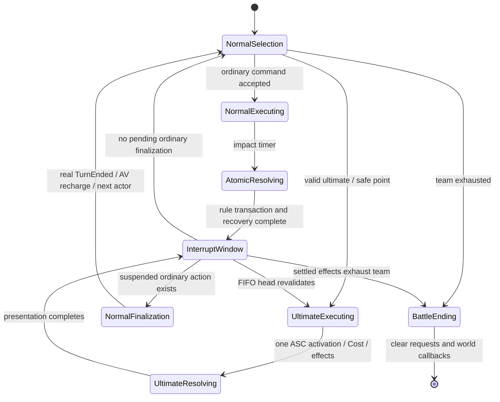

# Ultimate mechanics design

2026-10-19. Engineering verification results are recorded separately in TEST-MATRIX.md and HANDOFF.md. Human acceptance is pending.

## References and final behavior

See REFERENCE-AUDIT.md for the actual fetched sources, failed source accesses, and baseline function evidence. Community observations describe player behavior, not HoYoverse source architecture.

| Reference | Implemented | Deliberate difference / boundary |
|---|---|---|
| KQM: an Ultimate interrupts turn order after the current attack finishes | Existing Coordinator accepts a battle-local extra-action request; normal atomic damage/effects and bounded presentation finish first | A .4-second impact and 1-second recovery are project presentation contracts, not a claim about original animation frames |
| Prydwen: own-turn Ultimate leaves the normal action available; consecutive Ultimates | Separate FIFO, no ordinary ResolveAction for Ultimate | GameThread acceptance sequence defines deterministic order; no float-time tie-breaking |
| KQM speed: base AV 10000/SPD and speed rescaling | Existing TurnManager retains its distance representation and speed delegates | No animation time advances AV; explicit GE speed and official advance/delay operations still work |
| KQM: Ultimate can use a buff during its owner's ongoing ordinary turn | StatusComponent still consumes only its ordinary TurnEnded identity | No invented skill-completion buff clock; owner-start/action-specific special character policies are not added globally |
| Standard per-character Energy | Existing ASC Energy/MaxEnergy, configured threshold and pure Energy Cost GE | Threshold may differ from MaxEnergy or actual Cost; special non-Energy resources remain outside this standard implementation |
| Community FIFO / additional action observations | Player Ultimates FIFO before suspended normal finalization and next normal action | No existing follow-up/counter engine was found; no speculative follow-up engine or claimed universal original priority table |
| Existing single-target and party target UX | SingleEnemy, SingleAlly, Self, AllEnemies and AllAllies intents | A queued confirmed target or group-set change cancels the request; no silent retargeting or player withdrawal |

## Authority and ownership

UI displays value DTOs and emits a confirmed command. Coordinator owns admission, request journal, safe points, generation, FIFO, and resumption. TurnManager owns only ordinary actor/AV/lifecycle. Existing ASC owns granted abilities and live attributes. Ability owns one synchronous behavior transaction and Cost. GE/AttributeSet/ExecutionCalculation own effects and bounds. Motion, light pulse and camera own cosmetics.

No second ASC, turn manager, persistent queue, or Widget resource ledger was introduced. Save schema remains 9; equipment source ownership remains unchanged. Binary authoring changes the existing Verina and Remiel skill assets in place. Existing character animations and lawful Engine primitives supply a minimal differentiated Ultimate presentation.

## Input, state and timing

Target selection is a UI intent before acceptance. Once confirmed, RequestAction/SubmitBattleCommand route Ultimates into RequestUltimate even during another impact's delegates. Ordinary commands Reject while presentation or dispatch depth is busy. Exactly the matching presented impact command may enter the core. One role can have one accepted/executing request at a time; replaying an existing ActionId reuses its final result.

The safe point has two gates: the synchronous Ability/GE transaction has returned, and bounded presentation recovery has completed. Missing animation assets/notifies cannot strand rules. Timers use a weak UObject binding plus captured generation and action ID. Reset/EndPlay increments generation and clears timers; old callbacks cannot settle a new battle. World pause pauses world TimerManager, so neither impact nor recovery runs while paused.

Normal selection A → B Ultimate → C Ultimate returns to A's selection. An executing normal A retains one pending finalization across B/C; only after the FIFO empties does it generate one ordinary TurnEnded and recharge. If that actor dies or is destroyed, the manager skips its invalid slot without inventing another action. At a safe point the Coordinator detects missing Actors/ASCs and applies the existing team-wipe authority.

## Resource stages and failure policy

1. **Accepted:** record ActionId, actor/skill/confirmed target IDs, sequence and generation. Reserve the actor's request slot; do not subtract Energy. Resource changes while waiting are permitted and revalidated.
2. **Execution commit:** at the head and again at impact validate live actor, battle, skill ownership/spec, configured threshold, GAS availability/status tags and the exact target set. Ability uses one CommitAbility with a pure Instant Energy Cost GE. During this synchronous Cost/effect atomic segment cancellation is disabled; there is no nested animation execution.
3. **Resolve or forced cancel:** pending invalidation costs zero. A failed committed transaction with no successful effect receives one equal positive Energy compensation GE. Applied Instant GE success uses WasSuccessfullyApplied, not persistent-handle IsValid or net attribute change: legitimate Energy-change delegates can recover Energy inside the spend. If some AOE targets have already settled and a later target dynamically refuses, retain those results and the one Cost, emit PartialSettlement, and do not grant a free partial action through a global refund. Cosmetic interruption after successful rules never refunds damage/healing.

Definition EnergyGain is the post-success recovery; defaults remain authored. Ordinary action gains, hit Energy (+10) and kill Energy (+10) pass through one Instant SetByCaller Energy GE and the existing AttributeSet cap. UI reads the resulting ASC values. Multi-target attacks prepare independent EffectContexts and specs before the one activation; each target resolves once. The primary result stays associated with the first target; extra results map in confirmed order. Per-target Break operations receive distinct child IDs, while presentation keeps the parent ActionId. Every simultaneous casualty is registered before the single terminal result.

## Logs and scope

Enable `-LogCmds="LogHSRUltimate Verbose,LogTemp Verbose"` for request accepted/rejected, safe-point start, one Cost, effect result, completion/cancellation and NormalTurnResumed. The request trace includes generation, BattleId, ActionId, accepted sequence, actor, target and live AV snapshots; group target effects include parent identity. Default Verbose avoids high-frequency production logging.

Special charge-based Ultimates, selectable enhanced modes, cinematic hit-by-hit interruption, follow-up/counter/phase-action categories, and original-character-specific buff exceptions are not implemented. Current extension seams are skill targeting/configuration, explicit GE effects, and the existing Coordinator safe point; they do not claim to reproduce all original characters.
