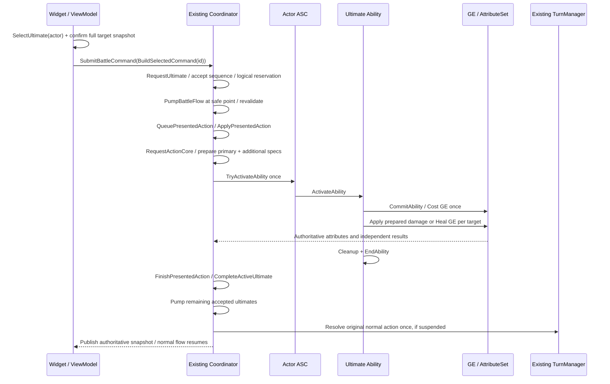

# 终结技真实源码导读

日期：2026-10-19。本文依据本轮集成后的当前源码说明执行链。构建、自动化、截图和试玩结论以 `TEST-MATRIX.md`、`HANDOFF.md` 的实际记录为准；本文不将源码存在等同于图形交互已通过，不代表最终人工验收。

工程根目录：`E:/work/unreal_projects/HSR`。下文均列真实文件与函数；没有额外引入第二个 TurnManager、ASC 或 Widget 调度队列。

## 1. 从队员卡片到一条明确的玩家意图

文件：`E:/work/unreal_projects/HSR/Source/HSR/UI/HSRBattleCommandWidget.cpp`。

`UHSRBattleCommandWidget::RefreshPresentationCards()` 读取 Coordinator 发布的 `Participants` 和 `UltimateSkills`。前者提供 ASC 投影出的生命、能量与上限，后者提供角色 ID、技能 ID、候选目标、可用原因，以及 `bPending`、`bExecuting`、`AcceptedSequence`。每名队员在原有队伍区域内显示终结技按钮，不另建一套资源账本。

按钮继续使用 `E:/work/unreal_projects/HSR/Source/HSR/UI/HSRBattleEntryButton.cpp` 中的 `UHSRBattleEntryButton::Select()`。技能卡调用所属 Widget 的 `SelectSkillById()`；终结技卡的展示 token 经 `UltimateCardActorIds` 转回真正的角色 ID，再调用 `SelectUltimate(ActorParticipantId)`。这个 Map 只路由点击，不保存 Cost、执行许可或请求队列。

文件：`E:/work/unreal_projects/HSR/Source/HSR/UI/HSRBattleCommandViewModel.cpp`。

`UHSRBattleCommandViewModel::SelectUltimate()` 使用角色 ID 查找该队员的终结技，维护本地选择 `SelectedUltimateActorId`、`SelectedSkillId`、`SelectedTargetId`。技能 ID 可能被多个角色共享，因此 `FindSelectedSkill()` 同时匹配角色与技能，不能只凭技能 ID 把 B 的按钮变成 A 的能力。

对于单体技能，选择可用目标仍走 `SelectTarget()`；在尚未提交时玩家可以调整目标。对于全体类型，VM 保持 `SelectedTargetId == NAME_None`，界面显示“全队”或“全体敌人”，高亮整个候选集合，不允许单击某人将群体技能缩成单体。

`BeginCommandSubmit()` 和 `RefreshCommandState()` 区别两种输入：

- 普通技能必须属于当前普通行动者，且为玩家行动、无普通挂起提交、无行动演出锁。重复提交直接拒绝；点击查看技能并不等于排队执行。
- 终结技使用所选队员 ID，不受“现在是敌方/其他队员回合”的普通输入锁限制，但仍检查当前战斗、技能可用、对应角色没有 pending/executing，以及目标有效。

因此敌方演出期间的终结技意图可以送达 Core，普通攻击不会被新队列偷偷接纳。UI 的 `bCommandPending` 继续只关联普通命令的提交；终结技等待状态来自权威 `UltimateSkills`，不会在 VM 再建一个等待名单。

**删除这一层的后果：** 如果 Widget 直接执行 ASC，玩家选择就会绕过仲裁；如果只沿用 `CurrentActorId`，非自身回合的终结技会错归当前行动者；如果把全局演出锁用于所有按钮，合法终结技输入会在到达 Core 前被吞掉。

## 2. 确认目标快照，再提交到唯一的战斗入口

文件：`E:/work/unreal_projects/HSR/Source/HSR/UI/HSRBattleCommandTypes.h`。

`FHSRBattleCommandSkillView::IsGroupTarget()` 识别 `AllAllies` 与 `AllEnemies`。`FHSRBattleCommandViewState::BuildSelectedCommand(ActionId)` 是纯值投影，组装战斗 ID、操作 ID、所选角色、技能与目标：

| 目标类型 | 提交内容 | 玩家选择语义 |
|---|---|---|
| `SingleEnemy` / `SingleAlly` / `Self` | 一个 `SelectedTargetId` | 沿用已有单目标交互 |
| `AllAllies` | 当时完整的 `CandidateTargetIds` | 全部存活同阵营，包含自己 |
| `AllEnemies` | 当时完整的 `CandidateTargetIds` | 全部存活敌对阵营 |

Widget 的 `SubmitSelectedSkill()` 生成 ActionId，并用所选终结技角色调用 `SubmitCommand()`。后者先取得 `VerifiedSnapshot`，经 VM 预检后，实际使用该快照的 `BuildSelectedCommand()` 构造命令，再核对命令汇 `GetActiveBattleId()`，最后调用接口 `SubmitBattleCommand()`。同一 Widget 收到相同 ActionId 时返回缓存结果，不重复发送。

文件：`E:/work/unreal_projects/HSR/Source/HSR/Battle/HSRTargetingPolicy.cpp`。

`FHSRTargetingPolicy::BuildCandidateTargetIds()` 读取真实参与者存活状态与阵营。`ValidateTargetIds()` 对全体类型要求提交集合与当前完整候选集合数量一致、成员一致且无重复。单体类型要求恰好一个合法 ID。

接受后的请求保留完整 `FHSRBattleActionCommand` 值。若排队期间有人死亡、离场，导致已确认集合不再匹配，后续校验取消原请求；不会将旧命令改写成新的目标集合。确认前新快照更新界面与确认后 Core 保存的请求是两个不同阶段。

**删除这一层的后果：** 如果执行时重新生成目标代替校验，玩家确认的是三个敌人，实际可能悄悄只打两个或换人；如果群体只提交第一个目标，后面的 GE、治疗与伤害结果根本无法与玩家意图对应。

## 3. 接受不等于执行：请求、FIFO 与安全点

入口文件：`E:/work/unreal_projects/HSR/Source/HSR/Battle/HSRBattleCoordinatorPresentation.cpp`。

`UHSRBattleCoordinator::SubmitBattleCommand()` 按角色技能配置判断类别。终结技进入 `RequestUltimate()`；普通命令在图形表现可用时进入 `QueuePresentedAction()`，否则进入现有 `RequestAction()`。不是把所有输入都放进同一个 FIFO。

仲裁文件：`E:/work/unreal_projects/HSR/Source/HSR/Battle/HSRBattleCoordinatorUltimate.cpp`。

`ValidateUltimate()` 检查 GameThread、战斗 ID 与状态、角色存活、定义和目标、ASC 的 AbilitySpec/实例、状态限制、门槛与 GAS 可支付性。`RequestUltimate()` 先查最终结果及请求历史，再拒绝同角色已 pending/active 的重复请求。合法请求保存完整命令、`BattleGeneration`，并由唯一仲裁点分配 `++NextUltimateSequence`，按接受顺序加入 `PendingUltimates`。

此时的资源预占是“该角色已经有一个未完成请求”的逻辑占位，没有立即改写 Energy，也没有共享战技点替代能量。能量或状态在等待期间变化，执行前必须重查。接受的请求没有玩家随意撤回入口。

`PumpBattleFlow()` 只有在没有外层命令派发、没有 `PresentedAction`、没有打开的形式化伤害事务时才能推进。它依次检查死亡、取出 FIFO 队首、重查 Generation 与终结技条件。失败请求经 `CompleteActiveUltimate()` 取消后继续处理后面的请求；合法请求成为唯一 `ActiveUltimate`。

因此 B、C 连续请求的行为是“当前原子动作结束 → B → C”，而不是同时激活两份全局演出。同帧顺序来自 GameThread 接受序号，不使用浮点时间戳猜先后。

**删除这一层的后果：** 队列会被当成无条件执行许可；死亡或不足能量的旧请求可能阻塞后续请求；在普通伤害委托中递归激活另一个技能还会破坏当前事务与死亡结算。

## 4. 演出边界与规则结算是两件事

`QueuePresentedAction()` 仅在没有另一份 `PresentedAction` 时建立表现记录。终结技先调用 `AHSRBattleStage::ShowUltimate()` 调整镜头，再调用 `PlayActionMotion()` 复用角色已有动画与 `UHSRCombatMotionComponent` 表现。它安排有界的 0.4 秒前摇，而不是等待一个可能缺失的 AnimNotify。

`SchedulePresentationPhase()` 位于 `HSRBattleCoordinatorUltimate.cpp`。回调用弱 UObject 绑定，并捕获 `BattleGeneration` 与 ActionId；旧战斗或旧行动不匹配时直接失效。World Timer 随 World 暂停暂停；销毁后的 UObject 不能继续通过该弱回调执行新战斗。

`ApplyPresentedAction()` 先检查 `bPresentedRulesResolved` 并立即置位，保证同一表现记录的规则入口只进入一次。终结技再次 `ValidateUltimate()` 后，通过 `RequestAction()` 进入 `RequestActionCore()`；`bApplyingPresentedAction` 和当前 ID 证明这次是合法命中阶段，不重新把它塞回终结技请求队列。

规则同步完成后保存 `PresentedResolution`，成功时播放命中表现，并安排 1 秒收尾。`FinishPresentedAction()` 要求规则已结算，清除表现记录，再完成 active 终结技并重新 Pump。

这套 0.4 秒命中加 1 秒收尾是本项目的最小演出合同，不代表原作帧数，也不表示已经逐帧验收现有每个动画。规则处理和表现记录都结束后，才会开启下一份额外行动。

**删除这一层的后果：** 仅以“动画播完”推进会在通知丢失时永久忙碌；仅以“GE 已执行”推进则会让 B 的镜头尚未收尾时 C 已开始演出；缺少 Generation/ID 检查会允许旧计时回调污染新战斗。

## 5. Coordinator 准备参数，ASC 激活能力，Ability 提交一次 Cost

文件：`E:/work/unreal_projects/HSR/Source/HSR/Battle/HSRBattleCoordinator.cpp`。

`RequestActionCore()` 使用 `ProcessedActionResolutions` 保护 ActionId 幂等，验证战斗、行动者、定义与精确目标集合。普通行动必须匹配 `TurnManager` 当前行动者；终结技必须匹配 `ActiveUltimate` 和 `bExecutingUltimateCore`，因此外部不能直接越过额外行动仲裁。

它通过行动者已有 ASC 的 `FindAbilitySpecFromClass()` 获取已授予实例，调用 `SetPendingTarget()` / `SetPendingTargets()` 安装这次操作的弱目标引用。攻击路径为每个目标准备独立伤害 Context、CritRoll 和 GE Spec，使用 `PrepareFormalDamage()` 保存主目标、`PrepareAdditionalFormalDamage()` 保存后续目标；此准备阶段尚未扣血。随后设置统一 `SetActionContext()`，只调用一次 ASC 的 `TryActivateAbility(AbilitySpec->Handle)`。

文件：`E:/work/unreal_projects/HSR/Source/HSR/GAS/Ability/HSRUltimateAbility.cpp`。

`UHSRUltimateAbility::ConfigureFromSkillDefinition()` 从 `UHSRSkillDefinition` 读 Ability 配置、Cost GE、效果 GE、退款 GE、释放阈值以及治疗标志。标准终结技要求 Cost/补偿为匹配的纯瞬时能量修改，没有角色名字分支。`UltimateReleaseThreshold` 独立于 `MaxEnergy`；即使达到门槛，仍须通过 `CheckCost()` 支付实际 Cost。

`ActivateAbility()` 在入口检查状态、目标与 `LastExecutedActionId`。通过预检后进入同步原子段，暂时禁止外部取消，预先建立补偿与治疗 Spec，再调用一次 `CommitAbility()`。后者进入覆写的 `ApplyCost()`：`bCostAttempted` 防止重入重复尝试，`bCostApplied` 记录实际施加结果。

这里以 `FActiveGameplayEffectHandle::WasSuccessfullyApplied()` 判断瞬时 GE 执行成功，不能用 `IsValid()` 将“没有持续活动句柄”误判成扣费失败。Cost 可以触发同步属性委托，因此也不能只拿 Energy 净变化是否恰好等于负 Cost 来判断成功。

**one Cost 的具体边界：** 一个父 ActionId、一次 ASC 激活、一次 `CommitAbility()`、一次成功 Cost；之后遍历多个目标应用效果，不按目标重复激活 Ability，不按目标重复扣费。`RequestUltimate()` 的角色占位、Core 的已处理结果缓存、Ability 的执行身份与 Cost guard 分别保护不同入口，不能仅靠按钮禁用承担幂等。

## 6. 伤害、治疗和 AttributeSet 如何成为真实结果

文件：`E:/work/unreal_projects/HSR/Source/HSR/GAS/Ability/HSRGameplayAbilityBase.cpp`。

攻击终结技调用 `ApplyPreparedFormalDamage()`。该方法先 Move/清空已准备的 Specs，再触发任何外部属性委托；`bApplyingPreparedDamage` 拒绝嵌套施加。`ApplyOnePreparedFormalDamage()` 对每个有效目标执行 `SourceASC->ApplyGameplayEffectSpecToTarget()`，读取该目标独立的结果与实际生命差。

主目标结果保留在 `LastFormalDamageExecutionResult`，额外目标结果保留在 `LastAdditionalFormalDamageResults`。整体 `bSucceeded` 表示至少一个目标结算成功，不会把某个后续目标的结果覆盖成主目标结果。如果同步委托导致部分目标失败，保留已生效伤害、打印 `UltimateDamage PartialSettlement`，已经部分结算的操作不退款伪装成“从没发生”。

Core 取回主结果到 `FHSRAbilityResolution::DamageResult`，逐项处理 additional results 的受击/击杀能量、韧性与击破，并产生独立目标伤害展示事件。额外目标击破/AV 操作使用子 ActionId 避免彼此被去重，但展示事件继续携带同一父 ActionId。父终结技仍然只有一次激活与一次 Cost。

治疗终结技在 `HSRUltimateAbility.cpp` 中先为所有目标建立并预检 Heal Specs；Cost 成功后逐个通过 ASC 应用治疗 GE，不在 Widget 或 Coordinator 中直接写 Health。全部没有生效且 Cost 已提交时，应用一次预先确认的补偿 GE；至少一个治疗生效而其他失败时保留效果与一次 Cost，并记录 `UltimateHeal PartialSettlement`。攻击路径同样只对完全失败、已提交 Cost 的操作补偿；成功伤害不会因后续表现取消而倒扣恢复。

文件：`E:/work/unreal_projects/HSR/Source/HSR/GAS/Attribute/HSRCoreAttributeSet.cpp`。

`PostGameplayEffectExecute()` 消费 `IncomingDamage`、清零元属性并扣减受限的 Health；治疗 GE 修改 Health 后继续裁剪到 `MaxHealth`。Cost、补偿或回能 GE 修改 Energy 后，统一裁剪到 `[0, MaxEnergy]`。这才是属性约束层，UI 读到的是 Coordinator 之后重新发布的 ASC 投影。

`UHSRUltimateAbility::ActivateAbility()` 的早退路径会清理待目标/待伤害并 `EndAbility()`；正常收尾记录 Cost、结果、补偿与能量前后值，恢复取消策略，再在实例仍 Active 时 `EndAbility()`。Ability 本身同步结束，演出记录可以继续收尾；两者不能混同为一个动画回调。

**删除这一层的后果：** 直接在 Widget 扣血会绕过 ASC/GE、属性上限及死亡委托；逐目标重新激活会多次扣费；重复使用 prepared specs 会重复伤害；把 additional result 覆盖主结果会使伤害数字、击破目标和父请求追踪混乱。

## 7. 收尾后为什么原普通回合仍在

`ResolveActionOrWait()` 位于 `HSRBattleCoordinatorPresentation.cpp`。终结技核心执行时直接返回，不调用普通回合 `ResolveAction()`；普通动作结算则把角色 ID 存入 `SuspendedNormalFinalization`。

`FinishPresentedAction()` 清除表现占用后，调用 `CompleteActiveUltimate()` 将匹配 ActionId 的唯一 active 记录置为 Completed 或 Cancelled，并将最终结果写入历史/幂等缓存。后续 `PumpBattleFlow()` 优先处理剩余终结技；没有额外请求才消费挂起的普通收尾：角色还存活则 `TurnManager->ResolveAction()`，失效则 `AdvancePastInvalidCurrentTurn()`。

文件：`E:/work/unreal_projects/HSR/Source/HSR/Battle/HSRTurnManager.cpp`。

`UHSRTurnManager::ResolveAction()` 才广播普通 `TurnEnded`、执行 `ApplyCurrentPendingAfterRecharge()` 并选择下一位普通行动者。终结技不会伪造一次普通回合、不会重新充值普通行动距离、不会因为演出耗时而推进全员 AV。已有速度属性委托 `HandleSpeedChanged()` 和正规击破/推进/延后入口仍然能修改真实行动距离；“不消耗普通 AV”没有冻结这些合法效果。

文件：`E:/work/unreal_projects/HSR/Source/HSR/Status/HSRStatusComponent.cpp`。

`UHSRStatusComponent::HandleTurnEnded()` 仅消费目标自己的普通回合结束，检查 BattleEpoch 与递增 TurnSequence 防重复。当前通用状态持续规则是这个已实现的 owner-end 入口；本文不声称已经实现所有特殊角色的 owner-start/action-specific 时钟。B 插队不会产生 A 的第二个 TurnEnded，因此不会额外扣 A 的状态回合。

对应的两条实际路线是：

- A 选普通命令时 B 请求：B 的安全点执行完，A 的普通行动权仍属于 A，没有挂起的 A 攻击要重复执行。
- A 攻击中 B/C 请求：A 的 GE 与必要结算完成，A 的表现收尾结束，B/C 依次执行，再收尾 A 的原普通回合一次。期间死亡与状态按更新后的权威参与者读取。

## 8. 对照阅读顺序与验证入口

独立 UI 意图测试在 `E:/work/unreal_projects/HSR/Source/HSR/Tests/HSRUltimateUITests.cpp`，测试名为 `HSR.UI.Ultimate.ActorIdentityAndEnemyWindow`、`PendingAndNormalLocks`、`AllAlliesIntent`、`AllEnemiesIntent`。这些测试覆盖真实 VM 与生产使用的命令投影，但不代替真实战斗 GAS 测试、动画逐帧或鼠标点击验收。

阅读日志时以父 ActionId 关联请求、接受序号、Cost、各目标结果与 Completion；用 BattleGeneration 区分连续战斗。图形验证、实际运行次数和失败修复证据必须查专项测试矩阵，不从本文的调用图推导 PASS。
